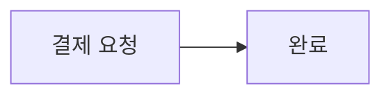
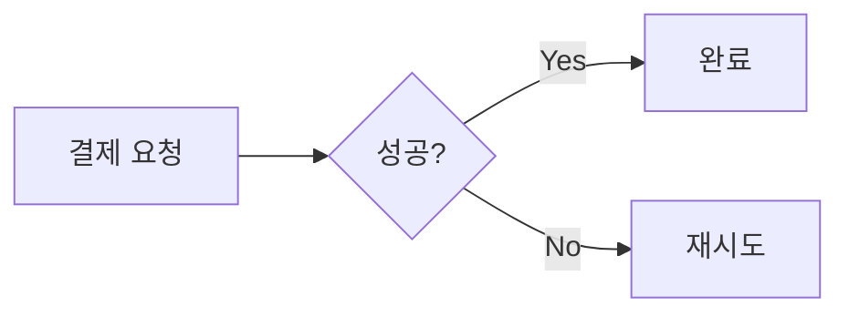
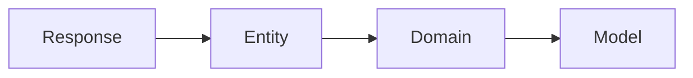
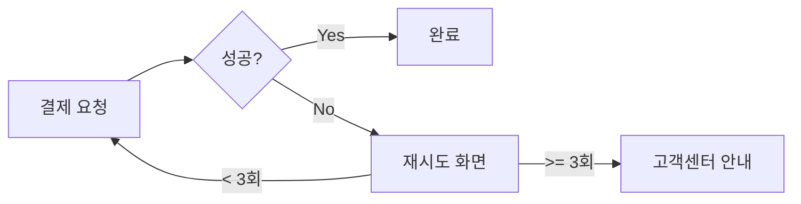

## Context

- Current branch: !`git branch --show-current`
- Remote URL: !`git remote get-url origin`

## Your task

### 0. 사전 검증
`git status`로 워킹 디렉토리 상태를 확인합니다.

- **커밋되지 않은 변경사항이 있는 경우**: 사용자에게 알리고 종료
  - "커밋되지 않은 변경사항이 있습니다. 먼저 커밋한 후 다시 PR 생성을 실행해주세요."
- **remote에 push되지 않은 커밋이 있는 경우** (`git ls-remote --heads origin <branch>`로 remote 브랜치 존재 확인 후, 있으면 `git log origin/<branch>..HEAD`, 없으면 신규 브랜치로 간주):
  - 확인 없이 `git push`를 실행한 후 계속 진행한다. (이 스킬에 진입한 것 자체가 push 동의를 의미하므로 별도로 묻지 않는다)

### 1. 기본 정보 추출
- 브랜치 이름에서 JIRA 티켓 ID 추출 (예: `feature/HDA-20017-*` → HDA-20017). 없으면 사용자에게 알리고 종료
- owner/repo는 `gh`가 현재 디렉토리의 origin remote로 자동 감지하므로 별도 추출하지 않는다

### 2. JIRA 티켓 조회
- `mcp__claude_ai_Atlassian__getAccessibleAtlassianResources`로 cloudId 가져오기
- `mcp__claude_ai_Atlassian__getJiraIssue`로 티켓 조회 (반드시 `fields: ["summary", "description", "parent"]` 명시)
- **인증 실패 시**: develop으로 임의 진행하지 말고, AskUserQuestion으로 **base 브랜치를 사용자에게 확인**한다.
  - 후보 제시: `develop` + `git branch -r | grep "origin/feature-base/"` 목록. 사용자가 고른 브랜치를 base로 3번 단계를 건너뛰고 진행한다. (PR 제목은 세션에서 확보한 summary나 사용자 입력을 사용)
  - 사용자가 재인증을 택하면 "'/mcp'로 JIRA를 재인증한 후 다시 '/create-pr'을 실행해주세요" 출력 후 종료한다.

### 3. base 브랜치 결정

| 조건 | base |
|------|------|
| 사용자 지정 | 지정 브랜치 |
| JIRA 에픽 있음 | `git branch -r \| grep "origin/feature-base/{EPIC-KEY}"` 결과로 결정 (0개→develop, 1개→해당 브랜치, 여러개→사용자 선택) |
| 그 외 | develop |

### 4. PR 본문 작성

#### 작성 원칙 (필수)

- 마크다운 형식으로 작성한다.
- **기본 본문은 최소형이다.** 아래 두 섹션만 쓰고, 나머지(작업사항·다이어그램 등)는 "예외일 때만 추가"한다. 단 **스냅샷 이미지가 커밋돼 있거나 바뀐 파일에 Compose Preview가 있으면 `## 반영화면`은 항상 채운다** (아래 "반영화면 작성 기준").

   ```markdown
   ## 개요
   <이 변경이 무엇을 하는가 — 1~2문장>

   ## 관련 채널 내용
   <Jira 본문에서 추출한 링크 — 있을 때만>
   ```

- **개요는 1~2문장**으로 "이 변경이 무엇을 하는가"를 적는다. 구현 방식·레이어·필드명은 본문에 적지 않는다.
- **문제 해결 문구는 기존 동작에 결함이 있었을 때만 쓴다.** 아직 구현되지 않은 기능을 새로 만드는 PR에 `~할 방법이 없던 문제를 해결합니다` 같은 결핍 프레이밍을 붙이지 않는다. Jira 본문이 그렇게 적혀 있어도 그대로 옮기지 않고, 무엇을 새로 추가하는지로 바꿔 쓴다.
   - 신규 구현 (O): `적립금 화면에 현재 적립금과 소멸 예정일 툴팁을 추가합니다.`
   - 신규 구현 (X): `딜러가 적립금을 확인할 방법이 없던 문제를 해결합니다.`
   - 결함 수정 (O): `필터를 초기화해도 이전 선택값이 남던 문제를 해결합니다.`
- **템플릿에 없는 섹션을 임의로 만들지 않는다.** `## 기타`·`## 변경 이유` 등 AI가 덧붙이는 섹션은 금지.
- **커밋 메시지와 중복 금지**: 커밋 제목/메시지를 PR 본문에 나열하지 않는다. 리뷰어는 커밋 목록을 별도로 본다. PR 본문은 "커밋 히스토리로는 보이지 않는 맥락"만 담는다.
- **구어체로 작성**: PR 본문 문장은 `~합니다` 체로 작성한다. `~한다` 같은 평서형 문어체는 사용하지 않는다.
   - 예: `~ 문제를 해결한다.` → `~ 문제를 해결합니다.`
- **작업사항·mermaid는 예외일 때만 추가한다.** 기본은 생략. 추가 기준은 아래 "작업사항·mermaid 추가 기준" 참고. 애매하면 생략한다.
- **쉽게 말하면은 정말 이해하기 힘들고 복잡한 경우에만 추가한다.** 기본은 생략. 추가 기준은 아래 "쉽게 말하면 추가 기준" 참고. 애매하면 생략한다.
- **반영화면은 스냅샷이나 Preview로 채운다.** 스냅샷 이미지가 이번 브랜치에 커밋돼 있으면 그것을 `## 반영화면`에 넣고, 이미 있던 스냅샷이 변경된 경우에는 Before/After 표로 넣는다. 스냅샷이 없으면 바뀐 파일의 Compose Preview를 찍어 넣는다. 작성 방법은 아래 "반영화면 작성 기준" 참고.

#### 반영화면 작성 기준

반영화면을 채우는 방법은 이 PR이 어느 계층을 바꿨는지에 따라 갈린다. **스냅샷 테스트는 디자인 시스템 컴포넌트에만 작성하므로**, 화면·피처 PR에 스냅샷이 없는 것은 정상이며 원인을 조사하지 않는다.

| PR이 바꾼 것 | 스냅샷 | 반영화면 |
| --- | --- | --- |
| 디자인 시스템 컴포넌트 | 있다 | 커밋된 스냅샷으로 채운다 (아래 "스냅샷으로 채우기") |
| 화면·피처 | 없는 것이 정상 | 바뀐 파일의 Compose Preview를 찍어 채운다 (아래 "Preview 캡처로 채우기") |

판정은 계층을 따로 추측하지 않고, 아래 "스냅샷으로 채우기" 1번 명령의 출력으로 한다. 출력이 있으면 스냅샷으로 채우고, 비어 있으면 Preview 캡처로 넘어간다. 디자인 시스템 PR에서는 Preview를 새로 찍거나 실기기 스크린샷을 대신 올리지 않는다. 스냅샷은 이미 커밋에 들어 있어 코드와 함께 갱신되므로 PR 본문이 낡지 않는다.

##### 스냅샷으로 채우기

1. 대상 이미지와 변경 유형을 함께 찾는다. `A`는 이번에 새로 추가된 스냅샷이고, `M`은 이미 있던 스냅샷이 변경된 경우다.

   ```bash
   git diff --name-status --diff-filter=AM {base}...HEAD -- '*/src/test/screenshots/*'
   ```

2. 각 이미지 URL은 **커밋 SHA로 고정**한다. 브랜치 이름을 ref로 쓰면 이름 안의 슬래시가 경로와 섞여 링크가 깨지고, 이후 force push로 그림이 바뀐다.

   ```
   https://github.com/{owner}/{repo}/raw/{SHA}/{경로}
   ```

   | 이미지 | SHA를 구하는 명령 |
   | --- | --- |
   | After (변경 후) | `git rev-parse HEAD` |
   | Before (변경 전) | `git merge-base {base} HEAD` |

   Before에 merge-base 커밋을 쓰는 이유는, 1번의 3점 diff가 바로 이 커밋을 기준으로 비교하기 때문이다. 이 링크는 push된 커밋에만 유효한데, After는 0번 단계에서 push를 먼저 하므로 순서가 어긋나지 않고 Before는 base 브랜치에 이미 올라가 있는 커밋이다.

3. 표의 모양은 **기존 스냅샷이 변경됐는지(`M`)** 에 따라 달라진다. 열 제목이나 행 제목으로 쓰는 상태 이름은 두 경우 모두 Preview 함수명을 그대로 쓰지 않고 **사람이 읽을 이름**으로 적는다 (`Preview` → 입력 전, `PreviewUsed` → 사용 완료).

   - **`A`만 있는 경우** (스냅샷이 이번 브랜치에서 처음 생겼다): 비교할 이전 상태가 없으므로 상태를 한 줄로 나열한다.

     ```markdown
     | 입력 전 | 사용 완료 |
     | --- | --- |
     |  |  |
     ```

   - **`M`이 하나라도 있는 경우**: Before/After를 열로 두고 상태를 행으로 나열해서, 리뷰어가 같은 상태의 변경 전후를 나란히 볼 수 있게 한다. 상태를 열로 두면 한 행에 이미지가 4개 이상 들어가 본문 폭을 넘기므로 이 방향을 뒤집지 않는다.

     ```markdown
     | 상태 | Before | After |
     | --- | --- | --- |
     | 입력 전 |  |  |
     | 사용 완료 | (신규) |  |
     ```

     같은 표에 `A` 이미지가 섞여 있으면 그 행의 Before 칸에는 `(신규)`라고 적는다. 존재하지 않는 변경 전 이미지를 임의로 채워 넣거나, 그 행을 표에서 빼지 않는다.

4. 폭은 `width="280"`을 기본으로 둔다. 원본 크기로 넣으면 본문이 화면을 넘긴다.

##### Preview 캡처로 채우기

스냅샷이 없으면 이 PR에서 바뀐 파일에 있는 Compose Preview를 찍어 올린다. 리뷰어가 앱을 실행하지 않고도 바뀐 화면을 볼 수 있게 하려는 것이다.

**찍을 수 없으면 섹션을 제거하고 PR 생성을 계속한다.** 아래 어느 단계에서 멈추더라도 스크린샷 때문에 PR 생성을 중단하거나 사용자에게 묻지 않는다.

1. 대상 파일을 찾는다. base 이후 추가·수정·이동된 `.kt` 중 `@Preview`가 있는 파일이 대상이다. `@PreviewLightDark` 같은 멀티프리뷰 어노테이션도 잡히도록 `@Preview` 접두사로 찾는다.

   ```bash
   git diff --name-only --diff-filter=AMR {base}...HEAD -- '*.kt' | xargs -r grep -l '@Preview'
   ```

   `@Preview`가 하나도 없으면 `grep`이 실패 코드로 끝난다. 출력이 비어 있으면 종료 코드와 상관없이 대상이 없는 것으로 보고 섹션을 제거한다 (스킬·룰 저장소, 화면과 무관한 변경 등).

2. 캡처한다. `capture-preview-screenshot` 스킬을 Skill 도구로 **한 번** 호출해 대상 파일을 모두 찍는다. 인자 맨 앞에 `[경로만]`을 붙여(`[경로만] <파일 경로> <파일 경로> ...`) 그 스킬이 "다른 스킬이 호출할 때" 규칙을 따르게 한다. 그러면 그 스킬은 사용자에게 묻거나 PNG를 열어 보이지 않고, 모듈별 묶음도 직접 처리한다.
   - 캡처는 모듈마다 수 분씩 순서대로 돌기 때문에, 호출하기 전에 `Preview 캡처 중: 파일 {N}개 (수 분 걸릴 수 있음)` 한 줄을 출력한다.
   - 돌려받은 PNG만 쓰고, 찍지 못한 모듈과 Preview는 건너뛴다 (app 모듈처럼 캡처 태스크가 없는 모듈 포함).

3. 업로드한다. 돌려받은 PNG 경로를 모두 모아 `upload-pr-image` 스킬을 한 번 호출하고, `SCREENSHOT_URL:` 줄의 URL을 그대로 쓴다. PNG 이름에는 `@Preview(name = "...")` 값이 들어가 공백이 섞일 수 있으므로, 경로는 하나씩 따옴표로 감싸 넘긴다.
   - 파일 이름이 겹쳐서 실패하면(종료 코드 2) 복사본을 만들어 다시 올리는 일은 `upload-pr-image` 스킬이 그 호출 안에서 처리한다. 호출할 때 복사본 이름은 원본 이름 뒤에 `-2`처럼 순번만 붙이라고 함께 넘겨, 돌려받은 URL이 어느 Preview의 것인지 알 수 있게 한다.
   - 그 밖의 업로드 실패는 섹션 제거로 처리한다.

4. 표를 만든다. 파일마다 파일 이름을 굵게 한 줄 쓰고, 빈 줄을 넣은 뒤 Preview를 열로 둔 표에 이미지를 나열한다. 빈 줄이 없으면 표가 앞 문단에 흡수돼 글자 그대로 렌더링된다.
   - 표 하나에는 3열까지만 둔다. 넘치면 3장씩 끊어 표를 이어 붙이고, 표 사이에는 빈 줄을 넣는다 (빈 줄이 없으면 두 표가 하나로 합쳐진다).
   - PNG 식별자(`<package>.<클래스>.<함수>…`)가 `<그 파일의 package>.<파일 이름>Kt.`(최상위 함수) 또는 `<그 파일의 package>.<파일 이름>.`(파일 이름과 같은 클래스·object 안의 함수)로 시작하는 것만 그 파일의 표에 넣는다. 포함 여부로 묶으면 `CarListScreen` 표에 `MarketCarListScreenKt` PNG가 섞인다. 넣을 PNG가 없는 파일은 굵은 이름 줄도 쓰지 않는다.
   - 열 제목은 스냅샷 3번과 같이 **사람이 읽을 상태 이름**으로 적는다. 함수명에서 `Preview`를 떼고 남은 말을 풀어 쓰되(`PreviewUsed` → 사용 완료), 대상 파일을 Read해서 그 함수에 `@Preview(name = "...")` 값이 있고 PNG 식별자 뒷부분에 그 값이 들어 있으면 그 값을 제목으로 쓴다. 상태를 특정할 수 없으면(`Preview`·`Preview1` 등) 함수명을 그대로 쓴다. 근거 없이 지어내지 않는다.
   - `alt`에는 PNG 식별자를 넣어 어느 Preview인지 추적할 수 있게 한다. 폭은 `width="280"`이다.
   - 이미지가 많아도 `<details>`로 접지 않고 모두 펼쳐 둔다.

   ```markdown
   ## 반영화면

   **MarketCarListScreen**

   | 비어 있음 | 로드됨 |
   | --- | --- |
   |  |  |
   ```

#### 작업사항·mermaid 추가 기준

`## 작업사항` 섹션은 **개요만으로 리뷰어가 변경 흐름을 이해할 수 없을 때만** 추가한다.

| 상황 | 본문 |
|------|------|
| 개요 1~2문장으로 충분 (단순 추가, DTO/레이어 배선, 이름 정리, 버그 픽스) | 작업사항 **생략** |
| 흐름이 있으나 글로 충분 | bullet 1~3개 |
| 화면/상태 전환·호출/데이터 흐름·모듈 구조 변경이 **리뷰의 핵심**이고 글로 설명이 어려움 | mermaid (`flowchart`/`stateDiagram`/`sequenceDiagram`/`classDiagram`) |

**애매하면 생략한다.** DTO/레이어 매핑처럼 기계적으로 자명한 흐름은 mermaid로 그리지 않는다.

#### 쉽게 말하면 추가 기준

`## 쉽게 말하면`은 **이 작업을 모르는 리뷰어가 개요를 읽고도 무엇이 왜 바뀌는지 정말 이해하기 힘든 경우에만** 추가한다. 대부분의 PR은 이 섹션이 없는 것이 정상이다.

| 상황 | 쉽게 말하면 |
|------|------|
| 개요 1~2문장으로 이해된다 (단순 추가, 문구·레이아웃 변경, DTO/레이어 배선, 이름 정리, 일반 버그 픽스) | **생략** |
| 낯선 도메인 개념, 여러 조건이 얽힌 노출·분기 규칙, 원인이 여러 단계를 거쳐 드러나는 버그처럼 개요만으로는 맥락이 잡히지 않는다 | 추가 |

- 위치는 `## 개요` 블록(`### 디자인 화면`·`### 관련 채널 내용` 포함)이 모두 끝난 다음, `## 작업사항` 앞이다.
- 글은 1~3문장으로 쓰고, 한 줄에 한 문장만 둔다. 문장 사이에 빈 줄을 넣지 않는다.
- 구성은 "무엇이 바뀌나 → 왜 → 누가/어디서 체감하나" 순서다.
- 클래스·함수·필드 이름을 옮기지 않고, 그 코드가 하는 일을 사용자가 보는 화면·기능 이름으로 풀어 쓴다. 코드 용어를 지운 뒤에도 문장이 성립하는지 확인한다.
- 표와 그림은 아래 "표"·"그림" 기준을 따른다.
- 근거는 Jira 본문과 커밋이다. 코드에 없는 효과는 지어내지 않는다.

**표**: 바뀌기 전과 후를 비교하면 글 다음에 반드시 표로 보여준다. `~에서 ~로 변경` 같은 문장이나 `A → B` 화살표로 쓰지 않는다.

- 헤더는 `| 항목 | 변경 전 | 변경 후 |`이고, 셀 값도 쉬운 말로 쓴다. 비교 대상이 하나뿐이면 `항목` 열을 뺀다.
- 실제로 바뀐 행만 넣는다. 변경 전·후가 같은 행은 넣지 않고, 달라지지 않는 것은 글로 쓴다.
- 전후가 아니라 모양별·탭별처럼 나란히 있는 것끼리의 차이도 표로 쓴다. 이때 헤더는 비교 대상 이름(`| 조작 | 세로 목록 | 가로 카드 |`)이다.
- 목록 항목 안에 중첩하지 않고 섹션 레벨에 둔다.

**그림**: 글보다 그림이 빨리 전달될 때만, 그 그림이 설명하는 글 바로 뒤에 넣는다. 이 섹션에 최대 3개까지 넣고, 그림이 없는 것이 정상이다.

| 바뀐 것 | 그림 | 비고 |
|---|---|---|
| 화면 흐름·분기 | mermaid `flowchart` | |
| 앱↔서버·CI↔서버처럼 주고받는 순서 | mermaid `sequenceDiagram` | 참여자 이름도 쉬운 말 (`앱`·`서버`·`빌드 캐시 창고`) |
| 상태가 바뀌는 규칙 | mermaid `stateDiagram-v2` | |
| 사용자가 겪는 단계별 경험 | mermaid `journey` | |
| 화면 모양·배치·구성의 전후 | 그린 이미지 (아래) | 폰 프레임 2개에 전후, 바뀐 부분만 강조색 |
| 일상 비유로 설명하는 구조 | 그린 이미지 (아래) | 큰 도형 + 짧은 라벨 |

- mermaid는 노드·참여자 7개 이하, 라벨은 쉬운 말로 쓰고, 바뀐 부분만 그린다.
  - `flowchart`는 노드 라벨을 항상 큰따옴표로 감싼다 (`A["견적 결과 화면 (첫 진입)"]`). 괄호·콜론이 따옴표 밖에 있으면 파싱 에러로 다이어그램이 깨진다.
  - `sequenceDiagram`·`journey`는 따옴표를 쓰지 않는다. 참여자 이름에 괄호·콜론을 넣지 않고, 설명이 필요하면 메시지 텍스트로 쓴다.
  - `stateDiagram-v2`는 상태 id에 공백을 쓸 수 없으므로 `s1 : 견적 요청 중`처럼 짧은 id에 설명 구문으로 쉬운 말을 붙이고, 전이는 id로 쓴다 (`s1 --> s2 : 딜러 연락`).
- 선과 상자로 되는 흐름·순서·상태는 mermaid를 우선한다. 모양·배치·비유처럼 mermaid로 어색한 것만 이미지로 그린다.

**그린 이미지 만들기·올리기**

시작 전에 Chrome 실행 파일을 확인한다. `test -x "/Applications/Google Chrome.app/Contents/MacOS/Google Chrome"`이 실패하면 이미지 경로를 시작하지 않고 mermaid나 글로 간다.

1. **그리기**: SVG를 Write로 `/tmp/pr-images/{JIRA-KEY}/{nn}-{슬러그}.svg`에 작성한다. 경로에 셸 변수를 쓰지 않고(Write는 `$TMPDIR`를 전개하지 않는다), 작업 레포 안에 만들지 않는다. `viewBox="0 0 1200 {600~800}"`에 `width`·`height`도 같은 값, 배경 흰색 `<rect>`, 색은 회색 계열 + 강조 1색, 글자 22px 이상·`font-family="-apple-system, 'Apple SD Gothic Neo', sans-serif"`로 그리고, 글자는 라벨 수준으로만 쓴다. 전후 비교는 왼쪽 `변경 전`·오른쪽 `변경 후` 폰 프레임에 바뀐 부분만 강조색으로 칠한다. 변경 후 상태가 여럿이면 변경 후 프레임을 상태 수만큼(최대 3개) 나란히 둔다.
2. **PNG 변환**: Chrome headless로 변환한다. PNG는 바로 나오지만 프로세스가 끝나지 않으므로 시간 제한으로 끊는다. `qlmanage`는 정사각형으로 잘라내므로 쓰지 않는다.
   ```bash
   perl -e 'alarm 15; exec @ARGV' -- "/Applications/Google Chrome.app/Contents/MacOS/Google Chrome" \
     --headless=new --disable-gpu --hide-scrollbars --no-first-run \
     --user-data-dir=/tmp/pr-images/{JIRA-KEY}/.chrome --force-device-scale-factor=2 \
     --window-size=1200,{높이} --screenshot=/tmp/pr-images/{JIRA-KEY}/{nn}-{슬러그}.png \
     "file:///tmp/pr-images/{JIRA-KEY}/{nn}-{슬러그}.svg"
   ```
   종료 코드는 무시하고 PNG가 생겼는지로 판정한다. 생성된 PNG를 Read로 열어 글자 깨짐·잘림을 확인한다.
3. **업로드**: `upload-pr-image` 스킬을 Skill 도구로 호출해 PNG 경로를 넘긴다. 직접 올리거나 URL을 조립하지 않는다.
4. **본문 삽입**: 스킬이 돌려준 `SCREENSHOT_URL`을 그대로 ``로 넣는다.
5. **실패 시**: 변환·업로드가 실패했으면 링크를 남기지 않는다. mermaid로 대체할 수 있으면 대체하고, 아니면 글만 남긴다.

**표·그림 점검**

1. 코드 용어를 지운 뒤에도 표 셀·mermaid 노드·이미지 라벨이 성립하는지 확인한다. 코드 내부 값(enum·상수·설정 키)은 역할로 풀어 쓴다 (`RICH` → `카드형`).
2. 표에 변경 전·후가 같은 행이 없는지 확인한다.
3. 이미지를 넣었으면 PNG를 Read로 확인했고, URL이 `SCREENSHOT_URL` 출력과 같은지 확인한다.

잘못된 형태 (X):

```markdown
## 쉽게 말하면
TradePopupCreator에 isPurchaseQuestionnaireRequired 분기를 추가합니다.
```

올바른 형태 (O):

```markdown
## 쉽게 말하면
견적 결과를 처음 본 고객에게만 구매 의향을 묻는 창을 띄웁니다.
구매 의향을 알아야 딜러 매칭을 더 잘할 수 있기 때문입니다.

| 항목 | 변경 전 | 변경 후 |
|---|---|---|
| 질문 창이 뜨는 때 | 견적 결과를 볼 때마다 | 처음 볼 때 한 번만 |
```

#### before/after 비교

변경 전/후 구조나 흐름을 mermaid로 비교할 때는 **반드시 별도의 mermaid 블록 2개로 분리**하여 작성한다. 하나의 블록에 `subgraph`나 좌/우 배치로 합치지 않는다.

- 각 블록 위에 `**Before**`, `**After**` 헤더를 붙여 구분한다.
- Before/After 블록은 동일한 다이어그램 유형(flowchart/sequenceDiagram 등)과 동일한 방향(LR/TD 등)을 사용해 비교하기 쉽게 한다.

예시:

~~~markdown
**Before**



**After**


~~~

#### 좋은 예 / 나쁜 예

**나쁜 예 1** (커밋 메시지 나열, 장황, 중복):

```markdown
## 개요
HDA-20017 이슈에 따라 이용약관 버튼을 추가합니다. 사용자가 로그인 화면에서 이용약관을 확인할 수 있도록 버튼을 추가하고, 클릭 시 이용약관 화면으로 이동하도록 합니다. 또한 이용약관 화면에서 뒤로가기 시 로그인 화면으로 돌아오도록 합니다.

## 작업사항
- feat: 이용약관 버튼 추가
- feat: 이용약관 화면 네비게이션 추가
- refactor: LoginViewModel 정리
- test: 버튼 클릭 테스트 추가
```

**나쁜 예 2** (자명한 DTO/레이어 흐름을 mermaid로 그리고, 코드로 보이는 구현·범위를 `## 기타`로 덧붙임):

~~~markdown
## 개요
서버에 필터 API가 추가됨에 따라 앱이 두 필터 값을 주고받도록 API/DTO 레이어를 추가합니다.

## 작업사항


- 응답에서 옵션 목록을 받아 전 레이어로 전달합니다.

## 기타
- 서버 배포 전 nullable + 빈 목록 폴백으로 처리했습니다.
- 컴포넌트 이름 정리(AccidentType* → AccidentRepairsSummary*)뿐입니다.
~~~

**좋은 예 — 기본 (최소형)** — 위 "나쁜 예 2"를 이 형태로 줄인다:

```markdown
## 개요
API 변경사항을 반영합니다.

## 관련 채널 내용
https://...
```

**좋은 예 — 예외 (mermaid 사용)** — 화면/흐름/구조 변경이 리뷰의 핵심일 때만:

~~~markdown
## 개요
결제 실패 시 재시도 플로우를 추가합니다. 재시도 3회 초과 시 고객센터 안내로 분기합니다.

## 작업사항


~~~

### 5. PR 생성
1. PR 템플릿 읽기 (`.github/PULL_REQUEST_TEMPLATE.md`)
2. JIRA 본문에서 링크 추출 (Figma, Slack 등)
3. 템플릿 섹션 채우기:
   - "## 개요": 4번 전략으로 작성 (필수)
   - "### 디자인 화면": Figma 링크 있을 때만
   - "### 관련 채널 내용": 관련 링크 있을 때만
   - "## 쉽게 말하면": 4번 "쉽게 말하면 추가 기준"에 해당할 때만 `## 개요` 블록 다음에 추가 (기본 생략). 이미지는 PR 생성 **전에** 업로드해 URL을 확보한다
   - "## 작업사항": 4번 "작업사항·mermaid 추가 기준"에 해당할 때만 추가 (기본 생략)
   - "## 반영화면": 4번 "반영화면 작성 기준"대로 스냅샷 또는 Preview 캡처로 채움. 둘 다 없거나 캡처·업로드에 실패하면 제거
   - 비어있는 섹션은 제거
4. PR 본문을 임시 markdown 파일로 저장한다 (예: `/tmp/pr-body-{티켓ID}.md`).
   - 본문에 mermaid·백틱·대괄호가 포함되므로 `--body`에 인라인하지 않고 **반드시 `--body-file`로 전달**한다. (`--body "..."`에 백틱을 넣으면 셸 명령 치환으로 깨진다)
5. `gh pr create`로 PR을 생성한다:
   - `--title "{티켓ID} {JIRA summary}"` — **반드시 JIRA summary 필드 값을 그대로 사용** (요약/가공/의역 금지)
   - `--base {3번에서 결정한 브랜치}`
   - `--head {현재 브랜치}`
   - `--body-file {4번 임시 파일}`
   - `--assignee @me` — assignee를 본인으로 설정 (`gh`는 `@me`를 현재 인증 사용자로 해석)

## 예시

| 상황 | 브랜치 | base | PR 제목 |
|------|--------|------|---------|
| 에픽 있음 | feature/HDA-20017-agreement-button | feature-base/HDA-20000-agreement | HDA-20017 [고객][이용약관] 이용약관 버튼 추가 |
| 에픽 없음 | feature/HDA-20018-notification-fix | develop | HDA-20018 알림 버그 수정 |

## 중요
- 사용자 명시 요청 시 해당 내용 우선
